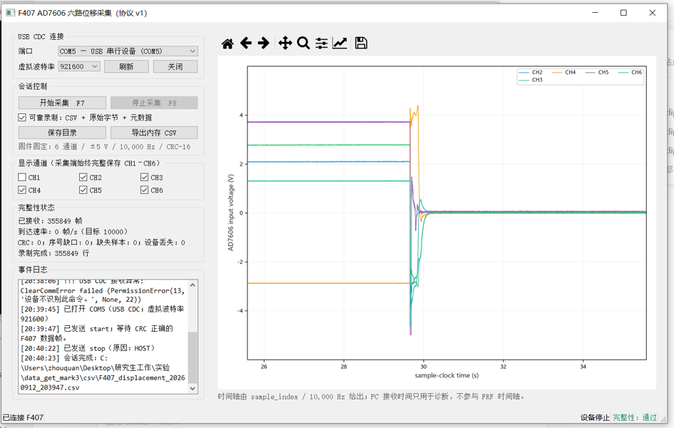

# 科研仪器采集与控制软件

Research Instrumentation and Control · Python / Qt / STM32 / ESP8266

面向磁悬浮铣削电主轴实验的平台软件，覆盖实验采集、操作 HMI 和电子手轮。这里仅归档科研软件，与机械设计接单作品及散热器控制软件分开维护。

## 实验采集

| 八路电流采集与校准 | 六路位移 / 电压采集 |
| :---: | :---: |
|  |  |
| [HSTS016L、AD7606、零点档案、CSV、上下位机应用源码 →](projects/current-acquisition/README.md) | [Mark3：实时波形、设备样本时间轴、CRC、CSV / RAW / 元数据 →](projects/research-daq/README.md) |

两套采集软件的通道、帧格式、时间基准和物理单位分别说明，不共用解析器或实验结论。

## 电主轴操作 HMI

[磁悬浮铣削电主轴 HMI →](projects/spindle-hmi/README.md)：XYZ 操作、G54、主轴状态、受限 G 代码及有线 / Wi-Fi 手轮接入；包含两版应用源码和无硬件回归测试。

## 电子手轮

[有线 USB 与 Wi-Fi 手轮 →](projects/dual-link-handwheel/README.md)：EC11 输入、XYZ 选择、五档增量、OLED、本次会话授权及断线撤权；附 STM32 应用源码和 ESP-01S 桥接源码。

## 运行与资料

各案例分别列出依赖、源码入口、协议和测试命令。仓库不包含实验原始数据、个人校准档案、厂商 DLL 或完整第三方 SDK。测试结果仅按各案例记录的范围描述，不把离线回归当作实机验收。

[作者主页](https://github.com/vincent886-zq)
