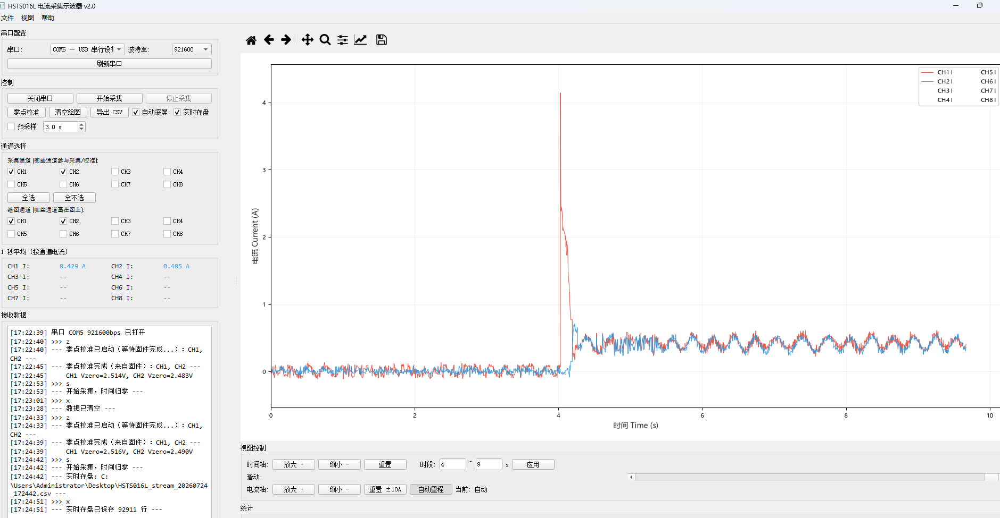
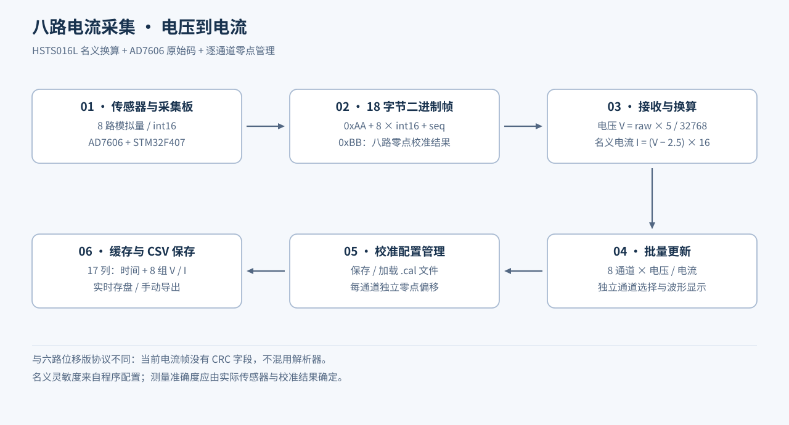

# 八路霍尔电流采集与校准软件

Python · PyQt5 · NumPy · Matplotlib · STM32F407 · AD7606 · USB CDC

面向磁悬浮铣削电主轴电流监测的实验采集软件。接收八路 AD7606 数据，将电压换算为霍尔传感器电流，支持逐通道零点校准、波形选择与缩放、定时／连续采集和 CSV 存盘，为后续电流—切削力分析提供数据入口。



图中实际启用 CH1、CH2 两路采集与绘图，界面保留八路选择和逐通道统计。该图用于展示软件操作与波形显示，不据此推定激励方式、测量精度或切削工况。



## 当前版本的功能

- **8 个物理通道、16 个数值量**：每路同时维护电压 V 和电流 A，不把电压／电流两条曲线误写成两个物理通道。
- 串口独立线程接收二进制帧，按最多 200 帧或约 20 ms 批量更新，绘图刷新与接收频率分离。
- 支持通道启停、显示通道切换、窗口缩放、统计与实时 CSV 写入。
- 零点校准结果支持 `.cal` 文件保存、命名、备注、加载和恢复；各通道单独保存零点及电流偏移。
- NumPy 预分配缓存上限为 3,000,000 组样本；缓存满后不再增加内存样本，已开启的流式 CSV 仍继续写入。
- 同时提供[上位机源码](src/main.py)与[采集卡应用层源码](firmware/Core/Src/main.c)，便于查看上下位机配合方式。

## 换算与帧格式

程序采用的名义换算为：

```text
V = raw_code × 5.0 / 32768.0
I_nominal = (V − 2.5) × 16.0
I_display = I_nominal − 当前通道的零点电流偏移
```

其中 2.5 V 和 16 A/V 是本程序用于 HSTS016L 的名义配置；不是本轮重新测定的传感器灵敏度。

| 项目 | 当前代码 |
| --- | --- |
| 数据帧 | `0xAA + 8×int16（小端）+ uint8 序号`，共 18 字节 |
| 校准帧 | `0xBB + 8×int16 零点编码 + 0x00` |
| 零点解码 | `Vzero = code / 10000.0` |
| 采集命令 | `s` 启动、`x` 停止；其余交互见源码 |
| 固件名义采样配置 | 10 kHz；不是本轮硬件吞吐测试结论 |
| CSV | 时间列 + 八组电压／电流，共 17 列 |

此版使用 PC 接收时间戳，且 18 字节协议没有 CRC 字段；与[六路位移版](../research-daq/README.md)的设备样本索引和 CRC 协议不同。序号缺口统计不等于 CRC 完整性验证，不将两者混为同一种数据质量保证。

## 源码结构

| 文件 | 内容 |
| --- | --- |
| [main.py](src/main.py) | 采集模式、界面交互与校准流程 |
| [serial_worker.py](src/serial_worker.py) | 18 字节帧、序号统计、电压／电流换算与批量发射 |
| [data_store.py](src/data_store.py) | 多通道缓存、偏移、统计与 CSV |
| [calibration_manager.py](src/calibration_manager.py) | 校准文件保存、加载及管理 |
| [plot_canvas.py](src/plot_canvas.py) | 波形与可见窗口绘图 |
| [AD7606 驱动](firmware/Core/Src/ad7606.c) | 并行采样接口与设备侧缓冲 |

上位机安装 [requirements.txt](src/requirements.txt) 后运行 `python src/main.py`。固件公开的是应用层快照，HAL、CMSIS、FreeRTOS 和完整 Keil 构建依赖由对应官方软件包补齐。没有上传实验 CSV、校准档案或个人路径配置。

STM32 配置／USB 适配代码保留原有版权头，随附相关组件的[许可文本](notices/ST-USB-LICENSE.txt)；厂商基础库不计为独立开发成果。

## 离线验证

[7 项测试](tests/test_current_pipeline.py)已通过：名义电流换算、全部 17 个拆包位置、序号回绕及缺口、噪声前缀、校准帧解码、缓存边界与 17 列 CSV、校准档案往返。缓存边界测试临时缩小测试实例容量，不修改源码配置。

```text
python tests/test_current_pipeline.py
```
