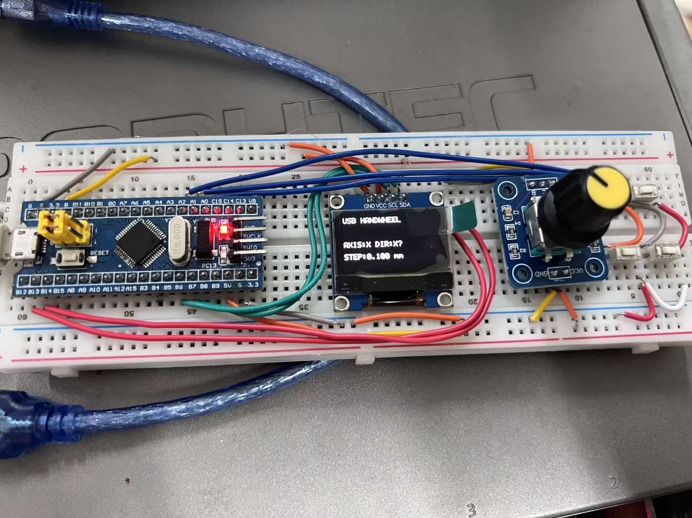
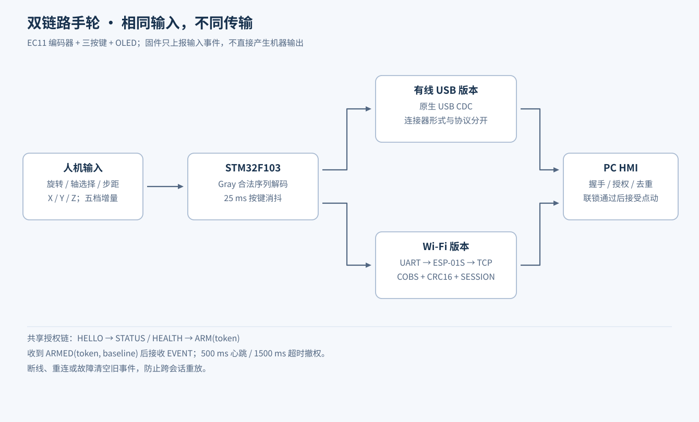

# EC11 电子手轮：有线 USB 与 Wi-Fi 双版本

STM32F103C8T6 · Embedded C · EC11 · SSD1306 · USB CDC · ESP8266

为电主轴实验平台 HMI 配套开发的输入手轮。两版共用旋转编码器、XYZ 轴切换、五档步距和 OLED 显示，分别通过有线 USB 与 ESP-01S Wi-Fi 传输输入事件。固件负责输入采集与会话管理，机器运动由 HMI 检查联锁后决定。



图为有线手轮实物原型，包含 STM32、EC11 和 OLED，不用它冒充 Wi-Fi 硬件照片。有线方案使用 USB CDC；Type-C 是接线／连接器形式，不是另一种应用协议。



## 公共输入与交互

| 功能 | 实现 |
| --- | --- |
| 编码器 | A/B 双边沿采样、合法 Gray 转移表与完整序列识别 |
| 轴选择 | X → Y → Z 循环 |
| 步距 | 0.01 / 0.05 / 0.1 / 0.5 / 1 mm，以整数微米传输 |
| 按键 | 轴选择、倍率增大、倍率减小；25 ms 稳态消抖 |
| 本地显示 | 轴、方向、步距、在线与授权状态 |
| 离线行为 | 本地显示可用；未授权输入不积压、不在重连后补发 |
| 心跳 | PC 约每 500 ms 发送 PING，固件 1500 ms 超时撤权 |

## 两版链路

| 版本 | 数据路径 | 应用源码 |
| --- | --- | --- |
| 有线 | STM32 原生 USB CDC → PC 串口 | [usb_handwheel](src/usb_handwheel/Core/Src/handwheel.c) |
| Wi-Fi | STM32 USART1 → ESP-01S → 单客户端 TCP → PC | [usb_handwheel_wifi](src/usb_handwheel_wifi/Core/Src/handwheel.c) |
| ESP 桥接 | ESP8266 Arduino 固件，负责 UART 与 TCP 桥接及链路诊断 | [esp01s_handwheel_bridge](src/esp01s_handwheel_bridge/esp01s_handwheel_bridge.ino) |

Wi-Fi 版本使用 COBS 定界、CRC16 和 SESSION 标识的板间协议，最大载荷 160 字节。ESP 不解析运动含义、不直接输出轴或主轴控制；当前桥接固件不是 ESP-AT 方案。

## 授权与事件协议

```text
HELLO → STATUS / HEALTH → ARM,<token>
ARMED,<token>,<baseline>
EVENT,<sequence>,<axis>,<step_um>,<direction>
```

HMI 必须核对本次令牌和序号基线，重复或失配事件会撤销接管。断线、新 HELLO、DISARM、超时、复位或链路故障会撤权并清空待发事件。输入事件不是运动许可，HMI 仍检查控制器状态、急停、限位、轴使能及点动模式。

## 源码与测试

- [有线版离线测试](src/usb_handwheel/tools/test_handwheel_logic.py)：编码器噪声序列、按键、五档步距、ARM 门控及源码契约。
- [Wi-Fi 版离线测试](src/usb_handwheel_wifi/tools/test_handwheel_logic.py)：增加 COBS／CRC 帧、会话隔离与桥接源码契约。
- 两个脚本本轮均通过，各覆盖 4,000 次带噪声的解码模型循环。它们验证主机侧模型与源码契约，不是对固件二进制的实机跑圈测试。
- 配套 [HMI](../spindle-hmi/README.md) 的有线／Wi-Fi 事件接入回归也已通过。

```text
python src/usb_handwheel/tools/test_handwheel_logic.py
python src/usb_handwheel_wifi/tools/test_handwheel_logic.py
```

仓库提供应用层源码与工程配置快照。固件编译还需配齐 STM32 HAL、CMSIS、USB Device 与对应 Keil 工具链；ESP 桥接需 ESP8266 Arduino Core。公开副本将 Wi-Fi 密码和 USB 厂商字符串改为示例值，未上传运行日志、个人配置或二进制包。

保留了 STM32 配置／USB 适配代码的原有版权头，相关组件许可随附于 [notices](notices/ST-USB-LICENSE.md)；其余依赖由对应 SDK 提供，不将厂商基础库计为独立开发成果。
