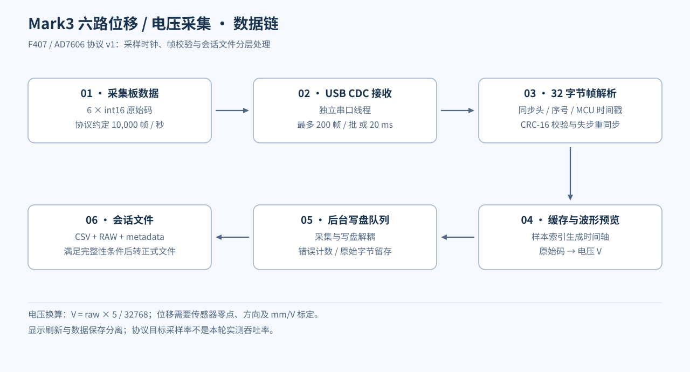

# F407 / AD7606 六路位移采集上位机

Python · PyQt5 · NumPy · Matplotlib · USB CDC · 二进制协议

面向磁悬浮电主轴实验的多通道采集工具。软件接收六路 AD7606 原始码，提供实时电压预览、采样序号与 CRC 检查，以及可追溯的采集会话文件。重点是让实验数据的时间基准、单位与完整性能够核对。



## 主要工作

- 将串口读取、帧解析、数据缓存、波形显示和后台写盘拆分成独立模块。
- 实现固定 **32 字节**帧的增量解析，支持粘包、任意位置拆包、噪声前缀及 CRC 失败后的重同步。
- 同时记录样本序号、MCU 微秒时间戳、六路原始码、电压和设备丢样计数。
- 采用批量信号更新界面：上限 200 帧／批或约 20 ms 发射间隔，避免每个样本触发一次界面刷新。
- 将 CSV、原始字节流、元数据一起保存；录制过程中使用 `.part` 文件，满足完整性条件后才更名为正式会话文件。
- 在串口线程内完成“安装原始流写入器—清空残留—重置解析器—发送 start”的会话边界操作。

## 数据与协议

| 项目 | 当前实现 |
| --- | --- |
| 通道 | 6 路有符号 16 位原始码 |
| 协议约定采样率 | 10,000 帧/s；来自设备采样约定，不由 PC 虚拟串口波特率决定 |
| 帧结构 | `A5 5A / version / type / channels / reserved / sample_index / timestamp_us / 6×int16 / device_drop_total / CRC16` |
| 校验 | CRC-16/CCITT-FALSE，初值 `0xFFFF`，多项式 `0x1021` |
| 时间轴 | `(sample_index − 首帧索引) / 10000` |
| 电压换算 | `V = raw × 5.0 / 32768.0` |
| 输出 | CSV、`.raw.bin`、`.metadata.json` |

这是位移实验的采集软件，但当前保存的是原始码和电压。转换为 mm 时还需应用实际传感器的零位、方向和 mm/V 标定，不能把原始码或伏特直接写成毫米。它与[八路电流采集软件](../current-acquisition/README.md)使用不同协议。

## 代码入口

| 模块 | 职责 |
| --- | --- |
| [main.py](src/main.py) | 连接管理、采集会话、统计与界面控制 |
| [serial_worker.py](src/驱动/serial_worker.py) | USB CDC 线程、批量发射、丢样与序号统计 |
| [f407_protocol.py](src/核心/f407_protocol.py) | 帧格式、CRC 和增量解析器 |
| [capture_writer.py](src/核心/capture_writer.py) | 后台队列与 CSV／RAW／元数据写入 |
| [data_store.py](src/核心/data_store.py) | 内存预览与流式存盘入口 |
| [plot_canvas.py](src/界面/plot_canvas.py) | 六路波形预览 |

安装 [requirements.txt](src/requirements.txt) 后运行 `python src/main.py`。公开内容为上位机应用源码，不含实验原始数据与个人配置。

## 离线验证

[8 项自动测试](tests/test_protocol_and_writer.py)已通过：CRC 标准向量、电压边界、全部 31 个拆包位置、连续帧与噪声、损坏帧重同步、非法帧头、有效会话转正式文件、无效会话保留 `.part`。测试使用合成字节，不代表采集卡实测带宽或测量精度。

```text
python tests/test_protocol_and_writer.py
```
