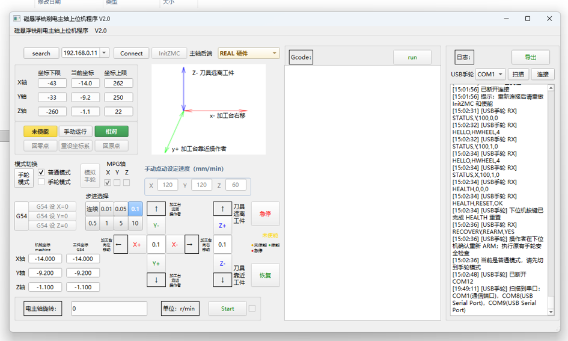
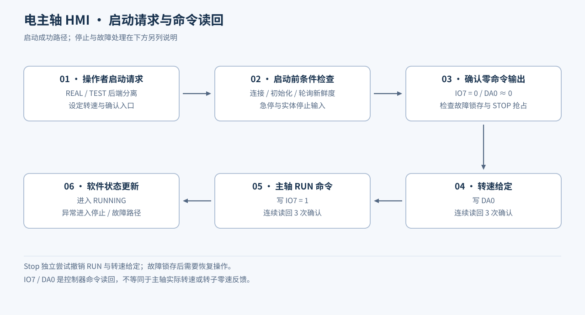

# 磁悬浮铣削电主轴 HMI 与运动控制上位机

Python · PySide6 · ctypes · ZMotion · 多线程 · USB / Wi-Fi 手轮

为磁悬浮电主轴实验平台开发的桌面操作界面，集中管理 XYZ 点动、坐标显示、G54 工件坐标、主轴命令、受限 G 代码执行及手轮输入。界面、轮询线程、主轴状态核心与厂商接口分层组织。

图为有线手轮版本的实际界面。Wi-Fi 版本沿用主要布局，改用 TCP 手轮连接；不把两版的连接控件混写成同一版本。

## 实现内容

- **XYZ 三轴操作**：相对／绝对点动、独立进给设置、连续模式、机械／工件坐标双显和 G54 分轴设零。
- **主轴状态管理**：区分 STOPPED、STARTING、RUNNING、STOPPING、FAULT；停止请求能抢占启动流程，异常进入故障锁存。
- **厂商 API 适配**：通过 `ctypes` 调用 ZMotion DLL，使用锁串行化底层调用；控制卡轴号与显示坐标分别映射。
- **交互与后台分离**：Worker 轮询输入、坐标和运动状态，GUI 显示结果；包含 PC 侧通信异常监测。
- **REAL／TEST 两种后端**：硬件控制卡与 TCP 测试服务分别处理，测试后端不等同于真实控制卡验收。
- **手轮接入**：接收有线／Wi-Fi 事件，经 ARM 令牌握手、状态检查与序号去重，再复用既有点动入口。

## G 代码与当前 Wi-Fi 版本

采用受限指令集，不是通用 CNC 解释器。支持 G0/G1、G4、G21、G54、G90/G91、G94/G95，以及 M3/M5；圆弧 G2/G3 与未实现的 M4 反转会拒绝执行。

Wi-Fi 快照还包含：整段程序预检、限位变化中止、目标 DPOS 复核、单段超时、自然结束停主轴，以及有确认入口的低速人工软限位恢复。代码中的 0.01 mm 是目标读回检查阈值，不能作为机床实际加工精度。

## 两套源码

| 版本 | 入口 | 配套测试 |
| --- | --- | --- |
| 有线 USB 手轮 | [usb/main_ui2.py](src/usb/main_ui2.py) | [手轮握手](src/usb/工具/test_handwheel_serial_stage1.py)、[主轴确认](src/usb/工具/test_spindle_start_confirmation.py) |
| ESP-01S Wi-Fi 手轮 | [wifi/main_ui2.py](src/wifi/main_ui2.py) | [TCP／授权测试](src/wifi/工具/test_handwheel_serial_stage1.py)、[主轴／G 代码／恢复测试](src/wifi/工具/test_spindle_start_confirmation.py) |

各版本保留自己的 `界面` 与 `核心` 目录，不能交叉混用。依赖为 PySide6；真实连接还需安装匹配位数、版本及授权条件的 ZMotion SDK，仓库不重新分发厂商 DLL。

## 本轮验证与能力边界

四个无硬件回归脚本均通过：有线握手与拒绝重放、主轴确认；Wi-Fi 本机 TCP 往返、授权撤销、G 代码结束、受限恢复和停止故障注入。测试使用模拟后端，未连接设备或发送真实运动命令。

REAL 模式确认的是 IO7／DA0 的控制器命令读回，不是主轴真实转速、磁悬浮 Ready、水流或转子零速反馈。当前为 PC 侧监测，没有控制器侧独立看门狗；软件界面不替代实体急停和驱动器保护。

配套项目：[双链路手轮](../dual-link-handwheel/README.md) · [电流采集](../current-acquisition/README.md) · [位移采集](../research-daq/README.md)
